# Ticketsmith — Architecture

How the code is organized and why. What the product must do: [requirements.md](requirements.md).

## 1. The big picture

Ticketsmith is organized **by feature** (vertical slices) on top of a shared **core**:

```mermaid
flowchart LR
  main[main.ts] --> bootstrap
  subgraph bootstrap[bootstrap/ — wiring only]
    cli[cli.ts] & mcp[mcp-server.ts] & root[composition-root.ts] & list[features.ts]
  end
  bootstrap --> features
  subgraph features[features/ — what Ticketsmith does]
    projects & doctor & tickets & process & dbs[databases] & changes & code & repos & know[knowledge] & mcpf[mcp]
  end
  features --> core
  subgraph core[core/ — reusable building blocks]
    project & secrets & tix[tickets] & dbk[database] & repok[repos] & agent & security & storage & knowledge & audit & output & clik[cli] & mcpk[mcp] & services & feature
  end
  core --> kernel[core/kernel — Result, errors, logger]
```



**Dependencies only point right.** `pnpm arch` (dependency-cruiser) fails the build otherwise.

| Layer | Answers | Contains | May import |
|---|---|---|---|
| `bootstrap/` | *How is everything wired?* | Composition root, feature list, CLI program, MCP server | Everything |
| `features/` | *What can Ticketsmith do?* | One folder per capability: its commands, MCP tools and logic | `core/` (public API) |
| `core/` | *What do features share?* | Domain models, ports and providers, masking, config, CLI and MCP contracts | Other core modules (public API), `kernel` |
| `core/kernel/` | *What does everything need?* | `Result`, `AppError`, logger | Nothing |

Two rules keep it navigable as it grows:
1. **A feature never imports another feature.** If two need the same thing, it moves to `core/`.
2. **Outside a module, only its `index.ts` is imported.** The `index.ts` is the module's public API.

## 2. Folder map

```
src/
├── main.ts                       process entry: builds the IO and runs the CLI
├── bootstrap/
│   ├── composition-root.ts       the only place that instantiates providers (JIRA, keychain…)
│   ├── features.ts               the list of features — add a feature here
│   ├── cli.ts                    builds the commander program from every feature's commands
│   ├── mcp-server.ts             registers every feature's tools; masks and audits all calls
│   └── tool-session.ts           one tool session per project: stdio for `mcp`, local HTTP for agent runs
├── features/                     one folder per capability (see features/README.md)
│   ├── projects/                 project init|status|refresh|add|remove|list|use|show|link|export|import, jira discover
│   ├── doctor/                   doctor
│   ├── tickets/                  list, show + MCP tools jira_get_issue, jira_search
│   ├── databases/                db ask + MCP tools db_select, db_select_group, db_schema
│   ├── repos/                    MCP tools repo_list, repo_files, repo_search, repo_read
│   ├── knowledge/                MCP tools knowledge_read, knowledge_search
│   ├── process/                  process <KEY> | --next: the agent investigates a ticket
│   ├── changes/                  changes list|show|approve|reject: the human decides on proposed DB changes
│   ├── classify/                 classify <KEY>
│   ├── evals/                    eval add <KEY>, eval [--full]
│   ├── code/                     code <KEY>|push|status|discard, feature <KEY>|approve|reject|implement|push|status + MCP code_run_tests, code_diff
│   └── mcp/                      mcp (serve), mcp setup
└── core/                         shared building blocks (see core/README.md)
    ├── kernel/                   Result, AppError, logger
    ├── publishing/               confirmed ticket writes (comments, transitions), audited by hash
    ├── classification/           ticket-types.md, rules, LLM fallback, the person's decision
    ├── agent/                    AgentRuntime port, Claude Code headless provider, playbooks, output schemas
    ├── project/                  Project model (optional integrations), project.yaml store, paths, profile migration
    ├── secrets/                  SecretStore port + keychain/env providers
    ├── storage/                  per-project SQLite (node:sqlite): onboarding steps, investigated catalog
    ├── knowledge/                masked Markdown writer, project brief
    ├── tickets/                  Ticket model, TicketSource port, ADF→Markdown, jira-cloud provider
    ├── database/                 read and write guards, preflight, change requests, DatabaseAdapter port, mysql provider
    ├── repos/                    git (no shell, reads from git objects), dedicated clones, ticket worktrees, PullRequestHost port + github/bitbucket-cloud providers
    ├── security/                 masking and the session placeholder vault
    ├── audit/                    AuditLog port + JSONL implementation
    ├── output/                   per-ticket output files
    ├── services/                 Services (what features get from outside) + DatabaseConnections (lazy, closes pools)
    ├── cli/                      command contracts, IO, prompts, option parsing, openProject, requireTickets
    ├── mcp/                      tool contract (defineTool, ToolContext)
    └── feature/                  the Feature type

tests/
├── unit/                         mirrors src/: src/a/b.ts → tests/unit/a/b.test.ts
├── integration/                  same mirror, against real services; skipped without their env var
├── support/                      fakes (in-memory ports), FakeCli, factories
└── fixtures/                     anonymized JIRA/ADF responses

scripts/                          developer scripts: MCP smoke test, guards, `pnpm release`
plugin/                           Claude Code plugin: MCP server via `npx ticketsmith@latest`, skills/
.claude-plugin/marketplace.json   marketplace that lists plugin/ (ADR 0020)
docs/                             requirements, architecture, roadmap, decisions/, guides/
```

## 3. Where do I put…?

| I want to… | Put it in | Guide |
|---|---|---|
| Add a CLI command | `features/<feature>/<name>.command.ts`, listed in the feature's `index.ts` | [adding-a-feature](guides/adding-a-feature.md) |
| Add an MCP tool for Claude | `features/<feature>/<name>.tool.ts` (`defineTool`), listed in the feature's `index.ts` | [adding-a-feature](guides/adding-a-feature.md) |
| Add a whole new capability | `features/<name>/` + one line in `bootstrap/features.ts` | [adding-a-feature](guides/adding-a-feature.md) |
| Add logic used by one feature | A plain file in that feature folder (`connect-ticket-source.ts`) | — |
| Share logic between features | A `core/` module, exported from its `index.ts` | — |
| Talk to a new external system | A port in `core/<module>/*.port.ts` + `core/<module>/providers/<name>/`, wired in `composition-root.ts` | [adding-a-provider](guides/adding-a-provider.md) |
| Give features a new dependency | `core/services/services.ts` (+ composition root and `FakeCli`) | — |
| Add a new integration (databases, repositories…) | Its config in `core/project/project.schema.ts` (`integrations`, optional), an investigator in `features/projects/onboarding.ts`, `requires` on its tools | — |
| Persist machine-generated facts | `core/storage` catalog (rebuildable cache) | — |
| Persist knowledge for the agent and the team | `core/knowledge` `writeKnowledge` (always masked) | — |
| Write a test | `tests/unit/` at the same path as the source file | §6 |
| Record an architectural decision | `docs/decisions/NNNN-title.md` | [decisions](decisions/README.md) |

## 4. Naming conventions

Files are `kebab-case`. **The suffix tells the role of a file at a glance:**

| Suffix | Role | Example |
|---|---|---|
| `.command.ts` | CLI command (thin: parse options, call logic, print) | `show.command.ts` |
| `.tool.ts` | MCP tool the agent can call | `search.tool.ts` |
| `.port.ts` | Interface with swappable implementations | `ticket-source.port.ts` |
| `.schema.ts` | Data shape (zod schema + inferred types) | `ticket.schema.ts` |
| `index.ts` | Public API of a module or feature | — |
| *(none)* | Logic: a use case or pure function, named by what it does | `connect-ticket-source.ts`, `adf-to-markdown.ts` |
| `.test.ts` | Test, only under `tests/` | `tests/unit/features/tickets/show.command.test.ts` |

Providers live in `providers/<vendor-or-tech>/` (`jira-cloud`, `keyring`, `env`). Identifiers are in English; everything in the repo is English.

## 5. Code style

- **Classes** only for providers and services with state or a lifecycle (HTTP client with a token, connection pool, vault): `implements` the port, constructor injection, `readonly #private` fields, no inheritance, no decorators, no DI container.
- **Pure functions** for transformations without side effects (ADF→Markdown, masking, rules, formatting).
- **Data** is a zod schema + `z.infer`, immutable. Zod validates every boundary: config files, JIRA responses, LLM output.
- **Errors:** expected failures are values, `Result<T, E>` with unions discriminated by `kind`; unexpected ones `throw` an `AppError`. CLI commands turn errors into messages with `orFail(result, describe…)`.
- **Commands are thin:** they parse options, call logic and print. Logic that is more than a few lines goes to a plain file in the feature.
- **Tools are pure of SDK details:** a tool returns `Result<string, string>`; masking, auditing and placeholder resolution are added by `bootstrap/mcp-server.ts` so no tool can skip them.
- `erasableSyntaxOnly` is on (Node runs the TS directly): no `enum`, namespaces or constructor parameter properties. No `any`. Imports carry the `.ts` extension; `import type` for types.

## 6. Tests

- `src/` holds production code only; `tests/unit/` mirrors it one-to-one.
- Fakes implement ports in memory (`tests/support/`); there are no scattered mocks. `FakeCli` runs real commands against fakes and a temp home dir.
- Tests import through the Node subpath aliases `#src/…` and `#tests/…` (package.json `imports`).
- No network in tests: HTTP goes through `FakeFetch` with fixtures shaped like the real APIs.
- Integration tests in `tests/integration/` (mirroring `src/`) run against real services when their env var is set (e.g. `TICKETSMITH_TEST_MYSQL_URL`, see [local-mysql](guides/local-mysql.md)) and are skipped otherwise; CI runs them with service containers.
- Checks against the real JIRA are scripts in `scripts/`, run on demand.

## 7. How a request flows

**CLI** — `ticketsmith show OPS-1`:
`main.ts` → `bootstrap/cli.ts` (program from `FEATURES`) → `features/tickets/show.command.ts` → `core/cli` `openProject` + `requireTickets` → `Services.connectTickets` (built by `composition-root.ts`) → `core/tickets` `TicketSource` → `jira-cloud` provider → Markdown to stdout.

**Onboarding** — `ticketsmith project init`:
`features/projects/init.command.ts` → configure integrations (`ticket-source-setup.ts`) → `onboarding.ts` runs each integration's investigator (`investigate-tickets.ts`), recording steps in `core/storage` → masked files via `core/knowledge` → `knowledge/brief.md`.

**Agent** — `ticketsmith process OPS-1`:
`features/process/process.command.ts` → `run-ticket.ts` → `CommandDeps.startAgentToolServer` (`bootstrap/tool-session.ts`: the project's tools on 127.0.0.1 with a per-run token, vault in this process) → `core/agent` `runStructured` → `Services.agent` (`ClaudeCodeCliRuntime`: `claude -p` with only those MCP tools) → validated answer → `vault.reveal` → `out/OPS-1/`.

**MCP** — Claude calls `jira_search`:
Claude Code → `ticketsmith mcp` → `bootstrap/mcp-server.ts` → `features/tickets/search.tool.ts` with a `ToolContext` (placeholders resolved by the session vault) → `TicketSource` → result masked by the vault → audited → back to Claude.

## 8. Stack

| Area | Choice | Notes |
|---|---|---|
| Runtime | Node 24 LTS, `engines: ">=24"` | CI tests 24 and 26 |
| Language | TypeScript 7, native ESM | Node runs `.ts` via type stripping; `tsc` only typechecks |
| Package manager | pnpm | |
| Build | tsdown | Bundles `dist/main.js` |
| CLI | commander + @clack/prompts + picocolors | |
| Validation | zod 4 | `z.toJSONSchema` for structured LLM output |
| HTTP | native `fetch` | Timeouts and retries in our own client |
| MCP | @modelcontextprotocol/sdk | stdio server |
| Secrets | @napi-rs/keyring | env fallback |
| Logging | pino to **stderr** with redaction | stdout belongs to CLI output and the MCP protocol |
| Tests | vitest | |
| Lint + format | Biome | |
| Architecture | dependency-cruiser (`parser: 'swc'`) | TS 7 has no JS API yet |
| Databases | mysql2 + node-sql-parser | Integration tests against MySQL in Colima/Docker locally and a service container in CI |

Later phases add the Claude Agent SDK.
